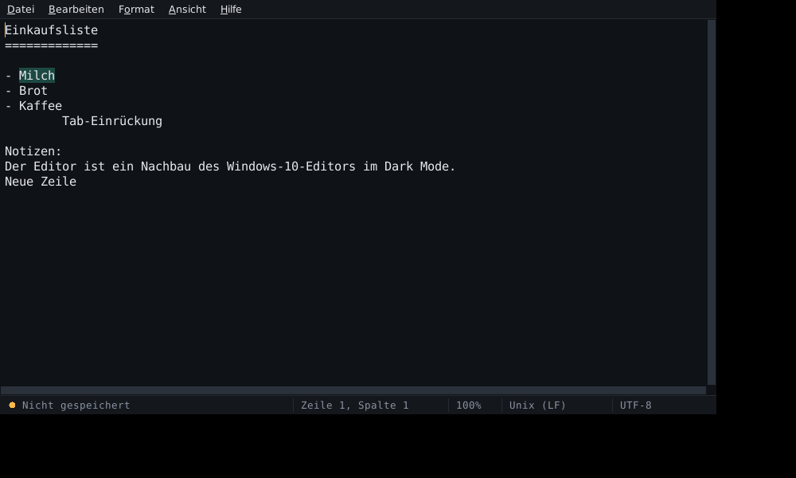

# Editor-Darkmode-MK1

Nachbau des **Windows-10-Editors (Notepad)** mit dunkler Oberfläche im Stil der Dashboards –
dunkler Grund, Teal-Akzent, Amber-Cursor. Läuft als **Windows-exe** und als **macOS-App**.

**Version:** 1.4.0



## Funktionen

Aufbau und Menüs wie im Original:

| Menü | Einträge |
|---|---|
| **Datei** | Neu, Neues Fenster, Öffnen, Speichern, Speichern unter, Drucken, Beenden |
| **Bearbeiten** | Rückgängig, Wiederholen, Ausschneiden, Kopieren, Einfügen, Löschen, Mit Bing suchen, Suchen, Weitersuchen, Vorheriges suchen, Ersetzen, Gehe zu, Alles markieren, Uhrzeit/Datum |
| **Format** | Zeilenumbruch, Schriftart, Codierung, Zeilenende |
| **Ansicht** | Zoom (Vergrößern / Verkleinern / Standard), Statusleiste |
| **Hilfe** | Hilfe anzeigen, Info über Editor |

* Statusleiste wie im Original: *Zeile/Spalte · Zoom · Zeilenende · Codierung*
  – zusätzlich ein Statuspunkt (Teal = gespeichert, Amber = ungespeichert).
  Ein Klick auf Codierung oder Zeilenende öffnet die Auswahl, ein Klick auf den Zoom setzt ihn auf 100 % zurück.
* Codierungen: UTF-8, UTF-8 mit BOM, UTF-16 LE/BE, ANSI (Windows-1252) – automatische Erkennung beim Öffnen.
* Zeilenenden: Windows (CRLF), Unix (LF), Macintosh (CR) – werden erkannt und beim Speichern beibehalten.
* Dunkle Titelleiste (Windows 10 ab 1809 / Windows 11), dunkle Dialoge, schmale Scrollbalken.
* Eigene, komplett dunkle Dropdown-Menüs ohne weißen Windows-Rahmen – bedienbar mit Maus
  (Hover-Wechsel zwischen den Menüs) und Tastatur (Pfeiltasten, Enter, Esc).
* Tabulatoren wie im Original: Tabstopps alle 8 Zeichen, ein Tab springt immer zur
  nächsten Tabstopp-Spalte; Tab und Umschalt+Tab fügen einen Tab ein und ersetzen eine Markierung.
* Kopierter oder ausgeschnittener Text bleibt nach dem Schließen des Editors in der
  Zwischenablage und kann woanders eingefügt werden (wie im Original).
* **Drag & Drop:** Dateien aus dem Explorer einfach auf ein offenes Editor-Fenster ziehen.
  Die erste Datei öffnet sich im Fenster (bei ungespeicherten Änderungen kommt vorher die
  Speichern-Rückfrage), weitere Dateien öffnen sich jeweils in einem neuen Fenster.
  Funktioniert auch, wenn der Editor als Administrator läuft.
* Zoom auch mit **Strg + Mausrad**.
* Aufruf mit Dateipfad (`Editor-Darkmode-MK1.exe datei.txt`) öffnet die Datei direkt – damit funktioniert auch „Öffnen mit …“.

### macOS-App

Die Mac-App ist dasselbe Programm mit denselben Menüs, Farben und Funktionen. Mac-typisch angepasst:

* Tastenkürzel zusätzlich mit **Cmd** (⌘N, ⌘S, ⌘F, ⇧⌘S …), im Menü mit Mac-Symbolen beschriftet;
  die Strg-Kürzel funktionieren ebenfalls.
* Rechtsklick bzw. Ctrl+Klick öffnet das Kontextmenü, Zoom auch mit **Cmd + Mausrad**.
* **Drag & Drop** von Dateien auf das Fenster (über *tkinterdnd2*) und zusätzlich auf das Dock-Symbol;
  im Finder steht der Editor unter *Öffnen mit* für Textdateien bereit.
* **Cmd+Q** fragt wie das Schließen-Kreuz nach ungespeicherten Änderungen.
* Zwischenablage über `pbcopy`, Drucken über den Standarddrucker (`lpr`).
* Dunkle Fensterrahmen, Schriften Helvetica Neue / Menlo (statt Segoe UI / Consolas).
* Die Menüs per Alt-Taste gibt es auf dem Mac nicht (Option+Taste erzeugt dort Zeichen wie @ oder {).

## Tastenkürzel

| Kürzel | Funktion | Kürzel | Funktion |
|---|---|---|---|
| Strg+N | Neu | Strg+F | Suchen |
| Strg+Umschalt+N | Neues Fenster | F3 / Umschalt+F3 | Weiter-/Rückwärtssuchen |
| Strg+O | Öffnen | Strg+H | Ersetzen |
| Strg+S | Speichern | Strg+G | Gehe zu Zeile |
| Strg+Umschalt+S | Speichern unter | Strg+A | Alles markieren |
| Strg+P | Drucken | F5 | Uhrzeit/Datum einfügen |
| Strg+Z / Strg+Y | Rückgängig / Wiederholen | Strg+Plus / Minus / 0 | Zoom |
| Strg+E | Mit Bing suchen | Alt+D/B/O/A/H, F10 | Menüs öffnen |

Auf dem Mac gelten dieselben Kürzel zusätzlich mit ⌘ statt Strg.

## Einstellungen

Alle Einstellungen (Schrift, Zoom, Zeilenumbruch, Statusleiste, Fenstergröße, Suchoptionen)
liegen menschenlesbar in **`Editor-Darkmode-MK1.ini` neben der exe**.
Ist der Ordner nicht beschreibbar (z. B. `C:\Program Files`), wird
`%APPDATA%\Editor-Darkmode-MK1\Editor-Darkmode-MK1.ini` verwendet.

macOS: `~/Library/Application Support/Editor-Darkmode-MK1/Editor-Darkmode-MK1.ini`
(das Programmverzeichnis einer Mac-App ist schreibgeschützt). Liegt bereits eine
`Editor-Darkmode-MK1.ini` neben der `.app`, wird stattdessen diese benutzt.

## Build per GitHub Actions (exe + Mac-App)

1. Inhalt dieser Zip in ein (neues) GitHub-Repository hochladen – **inklusive des Ordners `.github`**.
   Beim Hochladen über die Weboberfläche werden versteckte Ordner manchmal ausgelassen;
   dann `.github/workflows/build-exe.yml` über *Add file › Create new file* von Hand anlegen.
2. Bei jedem Push baut der Workflow **Build Windows EXE + macOS App**
   (Download unter *Actions › Lauf › Artifacts*):
   * `Editor-Darkmode-MK1-vX.Y.Z-windows.exe`
   * `Editor-Darkmode-MK1-vX.Y.Z-macos.zip` (Apple Silicon, enthält `Editor-Darkmode-MK1.app`)
3. Gibt es für die Versionsnummer (`APP_VERSION` in `editor_darkmode.py`) noch kein Release,
   wird automatisch ein Release `vX.Y.Z` mit exe, Mac-App und Offline-Build-Kit erstellt.
   Für ein neues Release also einfach `APP_VERSION` erhöhen.

Beide Builds nutzen dieselbe Bauvorschrift `Editor-Darkmode-MK1.spec` und die festen
Paketversionen aus `requirements-build.txt`.

**Mac-App zum ersten Mal starten:** Die App ist nicht von Apple signiert. Nach dem Entpacken
die App in *Programme* ziehen, dann einmal **Rechtsklick › Öffnen › Öffnen**. Danach startet
sie normal. Alternativ im Terminal: `xattr -cr /Applications/Editor-Darkmode-MK1.app`

## Offline bauen (ohne GitHub)

Der Ordner **`offline_build_kit`** enthält ein Offline-Build-Kit: Der Mac lädt einmal alle
Pakete herunter, danach baut der Windows-10-PC die exe und der Mac die App, beide ohne
Internet und mit identischem Ergebnis wie GitHub Actions. Schritt-für-Schritt-Anleitung:
[`offline_build_kit/ANLEITUNG.md`](offline_build_kit/ANLEITUNG.md).

## Lokal bauen / starten (mit Internet)

* Starten ohne Build: `python editor_darkmode.py` (Python 3.10+, keine Zusatzpakete nötig;
  auf dem Mac für Drag & Drop aufs Fenster zusätzlich `pip install tkinterdnd2`)
* exe lokal bauen: `build_local.bat` doppelklicken → `dist\Editor-Darkmode-MK1.exe`
* Mac-App lokal bauen: `./build_local_mac.sh` → `dist/Editor-Darkmode-MK1.app`

## Projektstruktur

```
editor_darkmode.py               Programm (Standardbibliothek / tkinter)
Editor-Darkmode-MK1.spec         gemeinsame PyInstaller-Bauvorschrift (exe + Mac-App)
requirements-build.txt           feste Paketversionen für den Build
assets/editor.ico, editor.icns   Programmsymbol Windows / macOS
tools/make_version_info.py       Versionsnummer + exe-Dateieigenschaften
.github/workflows/build-exe.yml  GitHub Actions: exe + Mac-App + Release
build_local.bat                  lokaler Build Windows
build_local_mac.sh               lokaler Build macOS
offline_build_kit/               Offline-Build-Kit (Mac lädt, Windows/Mac bauen)
```

## Unterschiede zum Original

* „Seite einrichten“ fehlt; „Drucken“ sendet das Dokument direkt an den Standarddrucker.
* Codierung und Zeilenende werden im Menü *Format* bzw. per Klick in der Statusleiste gewählt
  (statt im Speichern-Dialog).
* Zusätzlich: *Wiederholen* (Strg+Y) und mehrstufiges Rückgängig.
