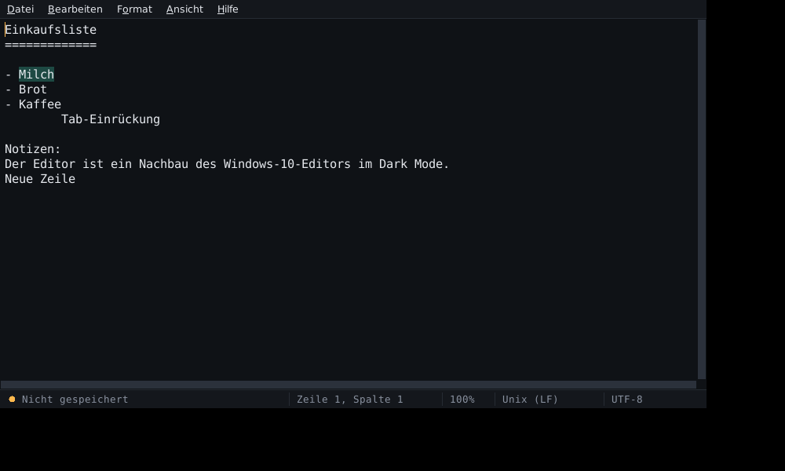

# Editor-Darkmode-MK1

Nachbau des **Windows-10-Editors (Notepad)** mit dunkler Oberfläche im Stil der Dashboards –
dunkler Grund, Teal-Akzent, Amber-Cursor.

**Version:** 1.1.0



## Funktionen

Aufbau und Menüs wie im Original:

| Menü | Einträge |
|---|---|
| **Datei** | Neu, Neues Fenster, Öffnen, Speichern, Speichern unter, Drucken, Beenden |
| **Bearbeiten** | Rückgängig, Wiederholen, Ausschneiden, Kopieren, Einfügen, Löschen, Mit Bing suchen, Suchen, Weitersuchen, Vorheriges suchen, Ersetzen, Gehe zu, Alles markieren, Uhrzeit/Datum |
| **Format** | Zeilenumbruch, Schriftart, Codierung, Zeilenende |
| **Ansicht** | Zoom (Vergrößern / Verkleinern / Standard), Statusleiste |
| **Hilfe** | Hilfe anzeigen, Info über Editor |

* Statusleiste wie im Original: *Zeile/Spalte · Zoom · Zeilenende · Codierung*
  – zusätzlich ein Statuspunkt (Teal = gespeichert, Amber = ungespeichert).
  Ein Klick auf Codierung oder Zeilenende öffnet die Auswahl, ein Klick auf den Zoom setzt ihn auf 100 % zurück.
* Codierungen: UTF-8, UTF-8 mit BOM, UTF-16 LE/BE, ANSI (Windows-1252) – automatische Erkennung beim Öffnen.
* Zeilenenden: Windows (CRLF), Unix (LF), Macintosh (CR) – werden erkannt und beim Speichern beibehalten.
* Dunkle Titelleiste (Windows 10 ab 1809 / Windows 11), dunkle Dialoge, schmale Scrollbalken.
* Eigene, komplett dunkle Dropdown-Menüs ohne weißen Windows-Rahmen – bedienbar mit Maus
  (Hover-Wechsel zwischen den Menüs) und Tastatur (Pfeiltasten, Enter, Esc).
* **Drag & Drop:** Dateien aus dem Explorer einfach auf ein offenes Editor-Fenster ziehen.
  Die erste Datei öffnet sich im Fenster (bei ungespeicherten Änderungen kommt vorher die
  Speichern-Rückfrage), weitere Dateien öffnen sich jeweils in einem neuen Fenster.
  Funktioniert auch, wenn der Editor als Administrator läuft.
* Zoom auch mit **Strg + Mausrad**.
* Aufruf mit Dateipfad (`Editor-Darkmode-MK1.exe datei.txt`) öffnet die Datei direkt – damit funktioniert auch „Öffnen mit …“.

## Tastenkürzel

| Kürzel | Funktion | Kürzel | Funktion |
|---|---|---|---|
| Strg+N | Neu | Strg+F | Suchen |
| Strg+Umschalt+N | Neues Fenster | F3 / Umschalt+F3 | Weiter-/Rückwärtssuchen |
| Strg+O | Öffnen | Strg+H | Ersetzen |
| Strg+S | Speichern | Strg+G | Gehe zu Zeile |
| Strg+Umschalt+S | Speichern unter | Strg+A | Alles markieren |
| Strg+P | Drucken | F5 | Uhrzeit/Datum einfügen |
| Strg+Z / Strg+Y | Rückgängig / Wiederholen | Strg+Plus / Minus / 0 | Zoom |
| Strg+E | Mit Bing suchen | Alt+D/B/O/A/H, F10 | Menüs öffnen |

## Einstellungen

Alle Einstellungen (Schrift, Zoom, Zeilenumbruch, Statusleiste, Fenstergröße, Suchoptionen)
liegen menschenlesbar in **`Editor-Darkmode-MK1.ini` neben der exe**.
Ist der Ordner nicht beschreibbar (z. B. `C:\Program Files`), wird
`%APPDATA%\Editor-Darkmode-MK1\Editor-Darkmode-MK1.ini` verwendet.

## Build per GitHub Actions

1. Inhalt dieser Zip in ein (neues) GitHub-Repository hochladen – **inklusive des Ordners `.github`**.
   Beim Hochladen über die Weboberfläche werden versteckte Ordner manchmal ausgelassen;
   dann `.github/workflows/build-exe.yml` über *Add file › Create new file* von Hand anlegen.
2. Bei jedem Push baut der Workflow **Build Windows EXE** die `Editor-Darkmode-MK1.exe`
   (Download unter *Actions › Lauf › Artifacts*).
3. Gibt es für die Versionsnummer (`APP_VERSION` in `editor_darkmode.py`) noch kein Release,
   wird automatisch ein Release `vX.Y.Z` mit exe und Zip erstellt.
   Für ein neues Release also einfach `APP_VERSION` erhöhen.

## Lokal bauen / starten

* Starten ohne Build: `python editor_darkmode.py` (Python 3.10+, keine Zusatzpakete nötig)
* exe lokal bauen: `build_local.bat` doppelklicken → `dist\Editor-Darkmode-MK1.exe`

## Projektstruktur

```
editor_darkmode.py            Programm (nur Standardbibliothek / tkinter)
assets/editor.ico             Programmsymbol
tools/make_version_info.py    erzeugt die exe-Dateieigenschaften aus APP_VERSION
.github/workflows/build-exe.yml  GitHub-Actions-Build + Release
build_local.bat               lokaler Build unter Windows
requirements-build.txt        PyInstaller für den Build
```

## Unterschiede zum Original

* „Seite einrichten“ fehlt; „Drucken“ sendet das Dokument direkt an den Standarddrucker.
* Codierung und Zeilenende werden im Menü *Format* bzw. per Klick in der Statusleiste gewählt
  (statt im Speichern-Dialog).
* Zusätzlich: *Wiederholen* (Strg+Y) und mehrstufiges Rückgängig.
